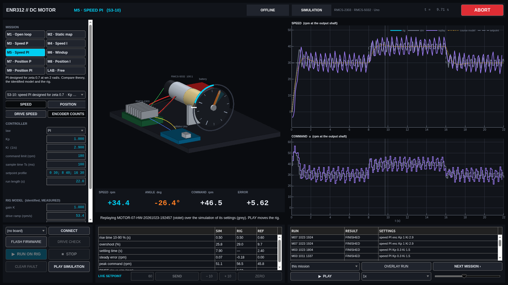
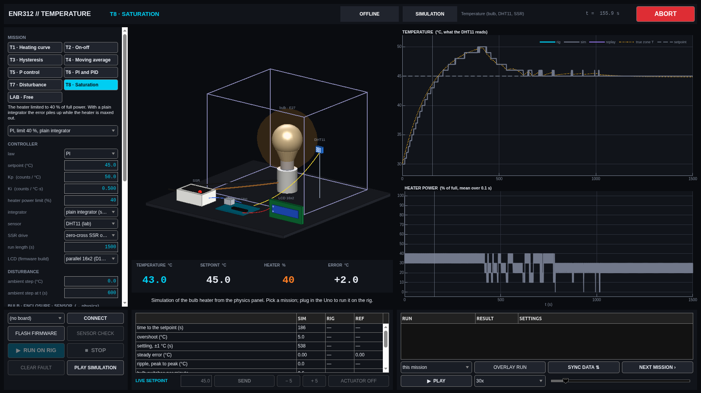
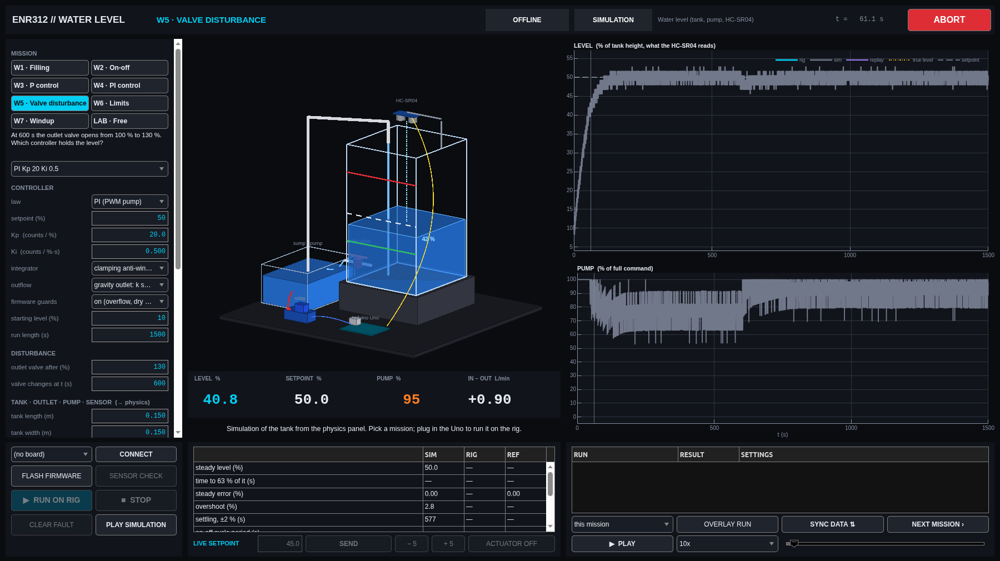

# ENR312 control lab: three rigs under real feedback

[](https://github.com/Samarth030312/enr312-lab/actions/workflows/ci.yml)


A DC motor behind a servo drive, a bulb heating a box, and a tank filled by a pump. Each
has an Arduino closing the loop and a MATLAB mission control that simulates it from its
own physics, runs it on the rig, records every run and replays it.

| DC motor · `enr312_motor` | Temperature · `enr312_temp` | Water level · `enr312_water` |
|:---:|:---:|:---:|
| [](docs/guide/README.md) | [](docs/guide/TEMPERATURE.md) | [](docs/guide/WATER.md) |
| A rig run (violet) over the identified model's prediction (grey): the handout's PI design overshoots 29 %, the model said 26 % | The bulb limited to 40 %: a plain integrator winds up and overshoots 5 °C | The outlet valve opens at 600 s: PI holds 50 % |

## Start

New computer: one line from [install/](install/README.md) (Windows cmd or PowerShell, macOS, Linux).
Then, in MATLAB, from the repository's `matlab` folder:

```matlab
enr312_start               % DC motor          enr312_start temperature   enr312_start water
enr312_doctor              % what is wrong with this computer, and the fix
```

Each app runs without hardware. Plug in the Uno and it offers to flash the firmware and connect.

## What the rigs showed

DC motor, 112 recorded runs, 2026-10-11 to 10-24 ([analysis](results/reports/dc_motor/2026-10-24/ANALYSIS.md),
[report 2026-10-24](results/reports/dc_motor/2026-10-24/REPORT.md)):

- The drive makes the motor a near-perfect speed source: slope 0.997, no dead zone down to 2 rpm.
- A step is the drive's 53 rpm/s ramp, not a lag. A model with that ramp and the measured Modbus
  latency predicts runs it never saw: median error 5.5 % of the setpoint, 83 runs.
- The textbook ζ 0.7 PI design overshoots 32 % (3 repeats, ±0.5) and limit-cycles; clamping
  anti-windup recovers in 0.5 s; P alone positions to two encoder counts.
- A full-speed reverse start at RUN (12 of 12 risky starts) is gone with a HOME at every RUN (0 of 21).

Temperature and water level: firmware and apps tested end to end against emulated hardware;
first rig sessions to come. Their physics panels take your bulb, box, tank and pump values.

## Where things are

| | |
|---|---|
| guides | [motor](docs/guide/README.md) · [temperature](docs/guide/TEMPERATURE.md) · [water](docs/guide/WATER.md) · [live session checklist](docs/LIVE_SESSION_CHECKLIST.md) |
| course questions | [MOTOR](docs/experiments/dc_motor/COURSE_QUESTIONS.md) · [TEMP](docs/experiments/temperature/COURSE_QUESTIONS.md) · [WATER](docs/experiments/water_level/COURSE_QUESTIONS.md) |
| every rig run | [`data/RUN_REGISTER.csv`](data/RUN_REGISTER.csv): `MOTOR-R0061_20261023-193103_M6` = apparatus, run number, time, mission |
| wiring and safety | [motor](docs/wiring/DC_MOTOR_WIRING.md) · [temperature](docs/wiring/TEMPERATURE_WIRING.md) · [water](docs/wiring/WATER_LEVEL_WIRING.md) · [checklist](docs/safety/EXPERIMENT_CHECKLIST.md) |
| software | [architecture](docs/architecture/MATLAB_ARCHITECTURE.md) · [serial protocol](docs/architecture/SERIAL_PROTOCOL.md) · [changelog](CHANGELOG.md) |
| sibling project | [rotary inverted pendulum](https://github.com/Samarth030312/enr312-rotary-inverted-pendulum) |

```
install/   one-line set-up        dc_motor/ temperature/ water_level/   firmware and its PC tests
matlab/    apps, models, tests    data/    every rig run, read-only     results/   reports, figures
```

## License

MIT ([`LICENSE`](LICENSE)). Arduino libraries are installed at pinned versions, not
redistributed ([`THIRD_PARTY.md`](THIRD_PARTY.md)). Course handouts and manuals are cited, not
redistributed.
