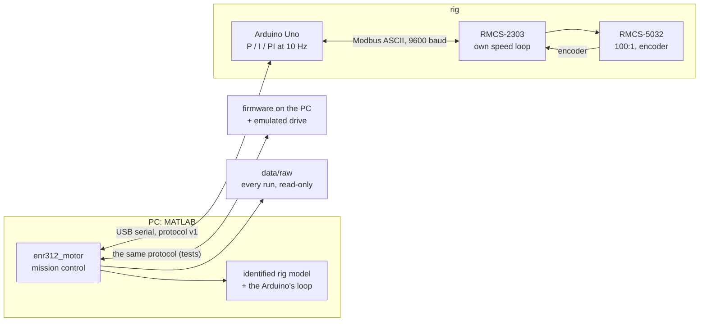

# ENR312 control lab: a DC motor under real feedback

[](https://github.com/Samarth030312/enr312-lab/actions/workflows/ci.yml)

-555)


A geared DC motor sits behind a servo drive that already runs its own speed loop. An Arduino
talks to that drive ten times a second over a slow serial bus and closes a second loop around
it: open loop, P, I and PI, on speed and on angle. This repository asks what each of those
controllers really does on that rig, and answers with the rig.

It contains:

- the Arduino firmware, tested on the PC against an emulated drive before it touched the motor;
- a model of the rig **identified from its own steps**, not from a datasheet;
- **`enr312_motor`**, a MATLAB mission control where every experiment of the ENR312 MOTOR
  handout is simulated, run on the rig, recorded and replayed in one window;
- every rig run, raw, with the reports that analyse them.

<p align="center">
  
  <br><sub>The handout's PI design (Kp 1.0, Ki 2.9) on the rig, in violet, over the identified
  model's prediction of the same run, in grey. The rig overshoots 29 %, the model said 26 %,
  the textbook 5 %.</sub>
</p>

## What we found

- **The actuator is a near-perfect speed source.** The drive closes its own loop, so the
  steady speed follows the command with slope 0.997 and **no dead zone** down to 2 rpm, in
  both directions (S3-3).
- **A step is a ramp, not a lag.** The drive limits acceleration to 53 rpm/s; a model with
  gain 1, that ramp and the 70 ms Modbus latency, fitted on four open-loop runs, predicts
  closed-loop runs it never saw within a few rpm (S3-4, S3-7).
- **The textbook PI design limit-cycles.** Designed for ζ 0.7 without the delay, it overshoots
  29 % instead of 5 % and then oscillates ±6.7 rpm; the identified model predicts both (S3-10).
- **Anti-windup is worth 6 seconds.** With the command saturated for 6 s, the firmware's
  clamping brings the speed back to the new setpoint in 0.5 s; a plain integrator would not be
  back before the run ends (S3-12).
- **P alone positions to two encoder counts.** 10° moves end within 0.11-0.17° for Kp 0.1 to
  1.0: the drive leaves no dead zone to stop short in (S3-5).
- **The guard works, and found something.** The firmware's runaway guard cut motor power in
  4 of 38 runs; three of them share a pattern (a full-speed reverse start), written down with
  the evidence and a proposed fix in the [session report](results/reports/dc_motor/2026-10-23/REPORT.md#safety-events).

## Start here

| I want to … | Go to |
|---|---|
| set it up on my computer (Windows, macOS, Linux) | [install: one line per system](install/README.md) |
| learn the app and do the experiments | [the mission-control guide](docs/guide/README.md) |
| answer the ENR312 MOTOR questions | [every task and question, mapped to its run](docs/experiments/dc_motor/COURSE_QUESTIONS.md) |
| see the rig results | [session 2026-10-23](results/reports/dc_motor/2026-10-23/REPORT.md) · [session 2026-10-11](docs/experiments/dc_motor/HW-SESSION-20261011-1314_FINDINGS.md) |
| wire the rig | [DC motor wiring](docs/wiring/DC_MOTOR_WIRING.md) and the [safety checklist](docs/safety/EXPERIMENT_CHECKLIST.md) |
| understand the drive and the motor | [hardware reference](docs/knowledge-base/HARDWARE_REFERENCE.md) · [control theory](docs/knowledge-base/CONTROL_THEORY.md) |
| see how the software fits | [MATLAB architecture](docs/architecture/MATLAB_ARCHITECTURE.md) · [serial protocol](docs/architecture/SERIAL_PROTOCOL.md) |
| see the sibling project | [rotary inverted pendulum](https://github.com/Samarth030312/enr312-rotary-inverted-pendulum) |

```matlab
% MATLAB R2023b or newer, from the repository's matlab folder
enr312_start        % checks the computer, installs the Arduino toolchain once, opens enr312_motor
enr312_doctor       % what is wrong with this computer, and how to fix it
```

New computer: one line in a terminal, from [install/](install/README.md):

```bash
curl -fsSL https://raw.githubusercontent.com/Samarth030312/enr312-lab/main/install/macos/install.sh | bash     # macOS
curl -fsSL https://raw.githubusercontent.com/Samarth030312/enr312-lab/main/install/linux/install.sh | bash     # Linux
```
```bat
powershell -NoProfile -Command "[Net.ServicePointManager]::SecurityProtocol='Tls12'; irm https://raw.githubusercontent.com/Samarth030312/enr312-lab/main/install/windows/install.ps1 | iex"
```

## How it fits together



The controller law exists once (`pidStep`): the firmware runs it, the simulation runs it, and
the firmware also runs on the PC against an emulated drive, behind the real serial protocol,
for the end-to-end test.

## Status

- **DC motor:** the course experiments S3-2 to S3-12 ran on the rig on 2026-10-23
  (38 runs) and are analysed; open: the runaway stop at the start of one run pair.
- **Temperature** (DHT11, bulb, SSR) and **water level** (HC-SR04, pump, relay): firmware tested
  on the PC, simulations and course answers done; not yet on hardware.
- **Pneumatics:** Festo FluidSIM, [plan](pneumatic/README.md).
- **Tested on:** the rig with Ubuntu 22.04. Windows 10/11 and macOS (Intel and Apple silicon):
  the installer, the firmware build and the MATLAB tests run in [CI](.github/workflows/ci.yml);
  a rig session from those systems has not been recorded yet.

## Repository layout

```
install/        one-line set-up for Windows, macOS, Linux
dc_motor/       motor firmware and its PC tests        temperature/, water_level/: the same for those rigs
matlab/         enr312_start, enr312_doctor, the apps, the models, analysis scripts, tests
data/           every rig run, raw and read-only, with metadata
results/        session reports, figures, simulation evidence
docs/           guide, course answers, wiring, safety, hardware reference, architecture
scripts/        build and validation helpers (shell), report tools
```

## License

MIT for the original work ([`LICENSE`](LICENSE)). Arduino libraries are installed from their
sources at pinned versions, not redistributed ([`THIRD_PARTY.md`](THIRD_PARTY.md)). Course
handouts and the drive and motor manuals are cited, not redistributed
([`SOURCE_REGISTER.csv`](docs/knowledge-base/SOURCE_REGISTER.csv)).
