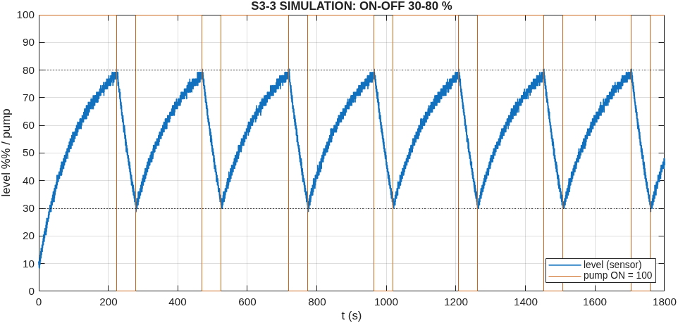
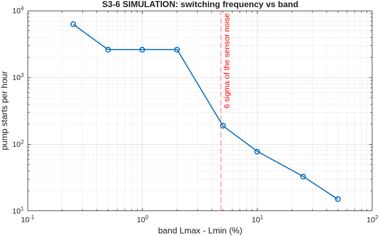
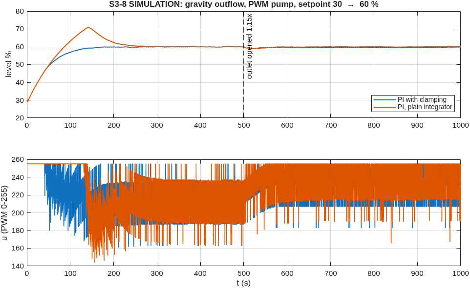
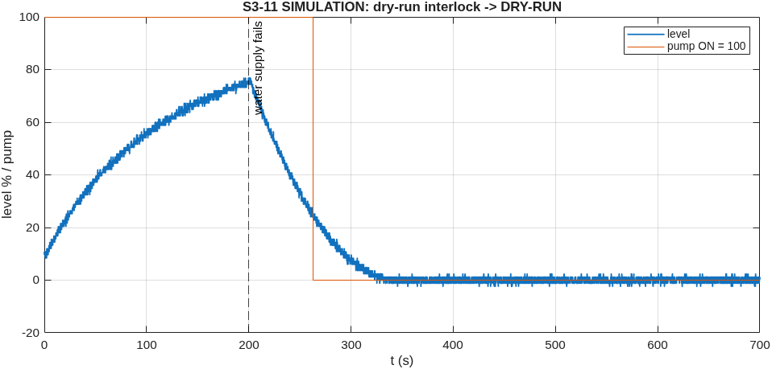

<!-- GENERATED by matlab/scripts/water_course_questions.m - do not edit; rerun the script -->
# ENR312 WATER handout: simulation and analysis results

Run `WATER-COURSE-SIM-20261024-120608`, generated 2026-10-24 12:06 by `matlab/scripts/water_course_questions.m` (MATLAB 26.1.0.3346908 (R2026a) Update 5, Simulink 26.1).
Data class: **SIMULATION**. Tank/pump ASSUMED: A = 225 cm^2 (15 x 15 cm), 100 % = 25 cm, sensor 30 cm above the floor, pump 4.0 L/min (67 mL/s) through a relay, gravity outlet sized so the pump alone settles at 96 %. Replace them with the measured values (S3-2, S3-3) and rerun.
Figures/CSV: `results/evidence/simulation_runs/water_level/WATER-COURSE-SIM-20261024-120608/`.

## S3-1 Ultrasonic level and the speed of sound
HC-SR04: the Arduino sends a 10 us trigger, the module emits 8 pulses at 40 kHz and holds ECHO high for the round-trip time t. Distance to the water d = v t / 2; **level = (sensor-to-floor) - d**. v = 331 + 0.6 T: 343.4 m/s at 20 C, 352.5 m/s at 35 C (+2.65 %).
| true level | distance to water | reading if code assumes 20 C, room 35 C | error |
|---|---|---|---|
| 0.0 cm (0 %) | 30.0 cm | 0.77 cm | **+0.77 cm (3.1 % of tank)** |
| 7.5 cm (30 %) | 22.5 cm | 8.08 cm | **+0.58 cm (2.3 % of tank)** |
| 12.5 cm (50 %) | 17.5 cm | 12.95 cm | **+0.45 cm (1.8 % of tank)** |
| 20.0 cm (80 %) | 10.0 cm | 20.26 cm | **+0.26 cm (1.0 % of tank)** |
| 25.0 cm (100 %) | 5.0 cm | 25.13 cm | **+0.13 cm (0.5 % of tank)** |
The error grows with the distance (empty tank worst). Firmware: `$CAL,1,<sensor_to_floor>,<full_height>,<air C>` uses v(T); the host test checks a 35 C room: 1.85 % error uncorrected, 0.10 % corrected.

## S3-2 Sensor calibration (procedure, simulated sensor)
| ruler (cm) | mean reading (cm) | residual after fit (cm) |
|---|---|---|
| 3.0 | 2.99 | +0.00 |
| 6.0 | 6.00 | +0.01 |
| 10.0 | 9.97 | -0.03 |
| 14.0 | 14.03 | +0.02 |
| 18.0 | 18.04 | +0.02 |
| 22.0 | 22.01 | -0.02 |
Fit reading = 1.0021 x ruler -0.019 cm; max error 0.03 cm, RMSE 0.02 cm; static noise (30 s at one level) std = **0.22 cm** (SIMULATION: model noise 2.0 mm, resolution 3 mm). On the rig: hold the level at 5+ ruler marks, record 30 s each in the app, run `enr312.level.calibrate`. Template: `docs/experiments/water_level/calibration_template.csv`. PENDING-HW.

## S3-3 / S3-4 / S3-5 Flows, ON/OFF times, overshoot (ON-OFF 30-80 %)

| quantity | value |
|---|---|
| rise rate, pump ON | 0.065 cm/s |
| fall rate, pump OFF | 0.219 cm/s |
| Q_out = A x fall rate | **49.3 mL/s** |
| Q_in = A x rise rate + Q_out | **63.8 mL/s** (model pump 66.7 mL/s) |
| T_on predicted A (Lmax-Lmin)/(Q_in-Q_out) | 193 s |
| T_on measured | 192 s |
| T_off predicted A (Lmax-Lmin)/Q_out | 57 s |
| T_off measured | 55 s |
| overshoot above Lmax after switch-off | 0.10 cm |
The formulas assume constant flows. With a gravity outlet Q_out = k sqrt(h) is larger near Lmax and smaller near Lmin, so the slopes (and the predictions) are averages - the predicted and "measured" times differ by that much. Overshoot: after the relay opens the pump keeps delivering for the relay + pipe delay and its spin-down (model: 1.0 s + 0.5 s), plus surface ripples and the 0.1 s sensor update. PENDING-HW: run "On-off 30-80 %" and apply `enr312.level.cycleAnalysis` to the raw file.

## S3-6 Band width, switching frequency, chattering
| band Lmax - Lmin | pump starts / hour | cycle period |
|---|---|---|
| 50.00 % (125.0 mm) | 15 | 245.3 s |
| 25.00 % (62.5 mm) | 33 | 113.5 s |
| 10.00 % (25.0 mm) | 78 | 47.3 s |
| 5.00 % (12.5 mm) | 189 | 19.0 s |
| 2.00 % (5.0 mm) | 2622 | 1.4 s |
| 1.00 % (2.5 mm) | 2622 | 1.4 s |
| 0.50 % (1.2 mm) | 2622 | 1.4 s |
| 0.25 % (0.6 mm) | 6240 | 0.6 s |

Halving the band roughly doubles the switching frequency (the tank needs half the time to cross it). Once the band approaches the sensor noise (here sigma = 0.80 % = 2.0 mm, so 6 sigma = 4.8 %) single noisy readings cross both thresholds and the relay chatters - the count jumps far above the 1/band trend. A relay rated for ~10^5 switching operations lasts 6667 h at the 30-80 % band but only 16 h at the narrowest band (and pump starts wear the motor too). Use a band well above the noise, plus a filter or a minimum on/off time.

## S3-7 Task-6 Simulink model (Relay block, constant outflow) tuned to the cycle period
Simulink `enr312_water_level.slx`, Relay block (pump OFF at Lmax, ON at Lmin), integrator tank, constant outflow (outGravity = 0). With A, Q_in from S3-3 and Q_out = 2.96 L/min the period is 228 s against 247 s for the "hardware" (here: the MATLAB model with the gravity outlet). Tuning Q_out to **3.07 L/min** gives **247 s vs 247 s**. On the rig, do the same with the measured period (PENDING-HW).

## S3-8 Nonlinear outflow, PI on a PWM pump: set-point step, extra drain, windup

| PI | overshoot | settling (2 %) | error after the extra drain | guard |
|---|---|---|---|---|
| clamping | 0.1 % | 116 s | 0.23 % | none |
| plain integrator | 10.8 % | 205 s | -0.08 % | none |
The PI holds the level after the extra drain (integral action finds the new pump speed). During the 30 -> 60 % step the pump runs at full speed (u = 255) for a long time: with a plain integrator the error keeps accumulating, so the level overshoots and settles later - **windup appears**; clamping prevents it. If the extra drain exceeds the pump's maximum flow (here a 1.4x drain at 60 %), no controller can hold the level: the pump runs flat out, the level falls, and the dry-run interlock stops the pump after 60 s.

## S3-9 Linearisation and time constants
A dh/dt = Q_in - k sqrt(h), k = a sqrt(2g). Around h0: sqrt(h) ~ sqrt(h0) + (h - h0)/(2 sqrt(h0)), so with deviations: A d(dh)/dt = dQ_in - k/(2 sqrt(h0)) dh  ->  **dh/dQ_in = K/(tau s + 1)**, K = 2 sqrt(h0)/k, **tau = 2 A sqrt(h0)/k**.
| level | tau | gain K |
|---|---|---|
| 7.5 cm (30 %) | **91 s** | 0.402 cm per mL/s |
| 20.0 cm (80 %) | **148 s** | 0.657 cm per mL/s |
tau grows with sqrt(h0): the outflow changes less per cm of level when the tank is fuller, so the tank is slower at Lmax than at Lmin (ASSUMED k; on the rig use k = Q_out/sqrt(h) from S3-3).

## S3-10 Self-regulating or integrating?
A free outlet (water leaves by gravity, Q_out = k sqrt(h)) is **self-regulating**: with a fixed pump speed the level settles where outflow = inflow. A pumped/constant outflow makes the tank a **pure integrator**: any mismatch makes the level rise or fall for ever. Which one our rig is depends on its outlet: **UNVERIFIED** - look at the rig (an open drain hole or tube = self-regulating). P control: in both cases the pump must keep delivering the outflow, which needs a non-zero error u = Kp e, so P alone leaves an offset (simulation, Kp 20, 60 %: gravity 9.94 %, constant 6.40 %); it can hold a level only if the outflow is zero. PI removes it.

## S3-11 Interlock: dry run and overflow
| level reading | float switch | pump commanded >= 200/255 for 60 s with < 2 % rise | sensor fails 5 pings | host silent 3 s | pump |
|---|---|---|---|---|---|
| > 92 % | any | any | - | - | **OFF** (overflow limit) |
| any | closed (water at top) | any | - | - | **OFF** (hardware overflow switch) |
| <= 92 % | open | **yes** | - | - | **OFF, latched** (dry run / blocked pipe) until STOP |
| - | - | - | **yes** | - | **OFF, latched** |
| - | - | - | - | **yes** | **OFF** |
| <= 92 % | open | no | no | no | controller output |
This is what `level_controller.ino` implements (host test: water_level/tests, all guards checked).

## S3-12 Why hardware and Simulink differ (to be filled with measured evidence)
Expected, each to be shown from the data: (1) pump flow depends on head and supply voltage, not constant (compare rise rates at low and high level); (2) relay + pipe delay and pump run-down -> overshoot above Lmax (S3-5); (3) ultrasonic noise from ripples and the 3 mm resolution (static std, S3-2); (4) outflow is not constant (fall rate vs level); (5) speed of sound vs room temperature (S3-1). PENDING-HW.

## Pending hardware runs (enr312_water, on the rig)
Calibration at 5+ ruler levels; On-off 30-80 
