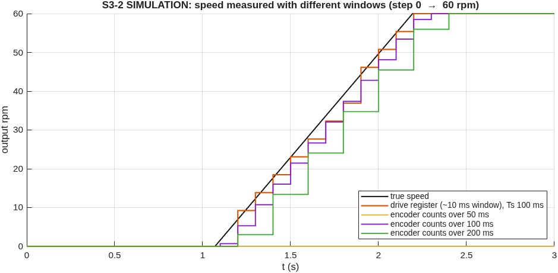
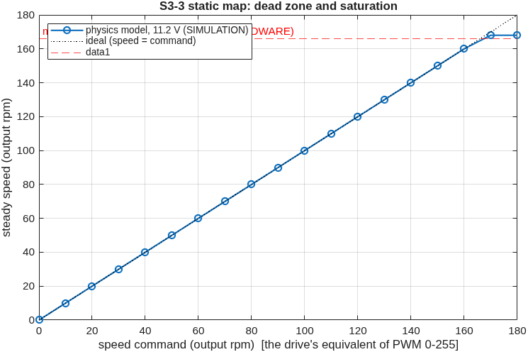
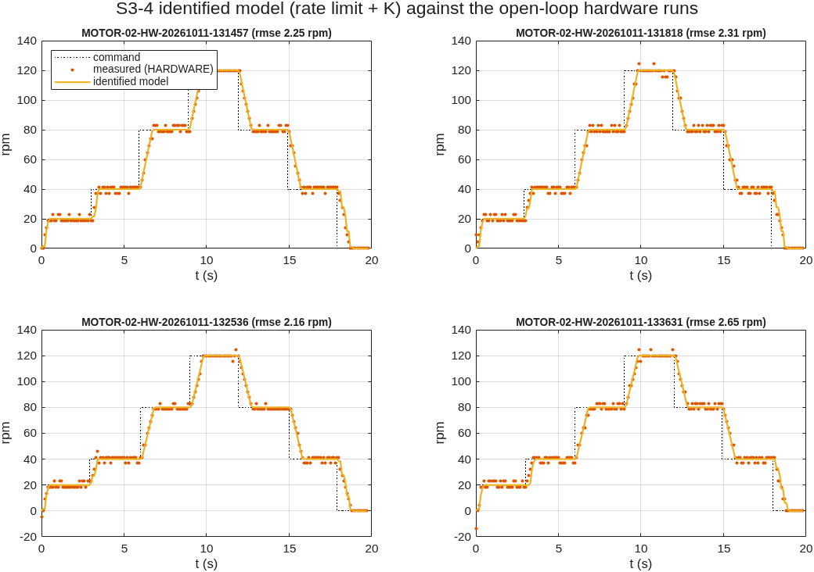
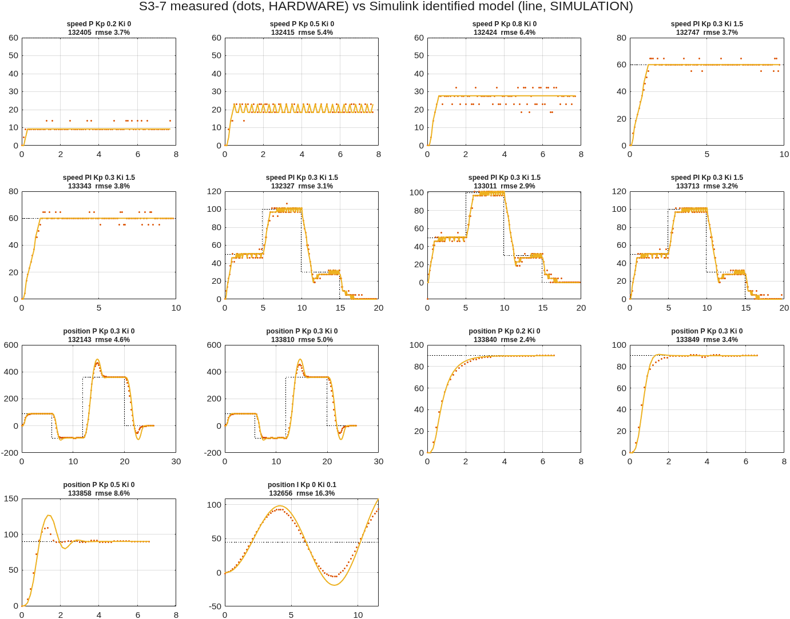
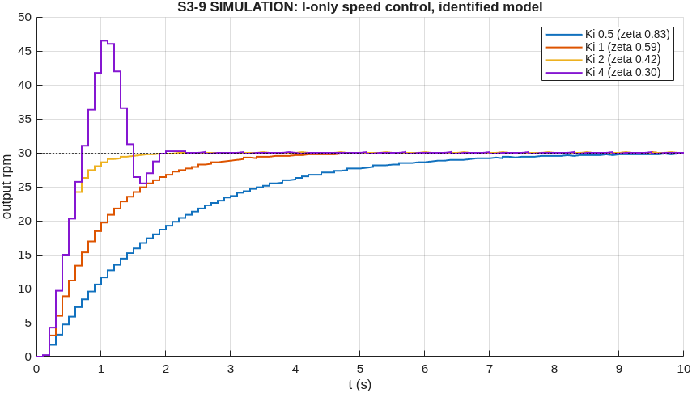
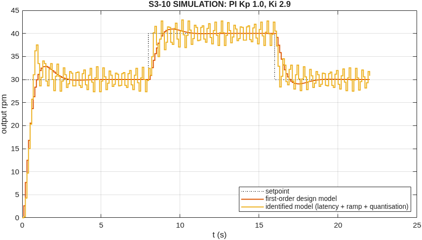
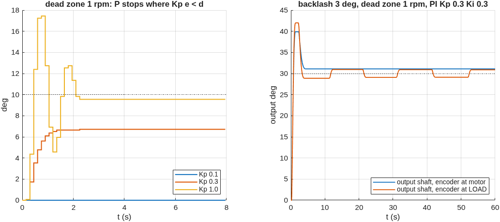
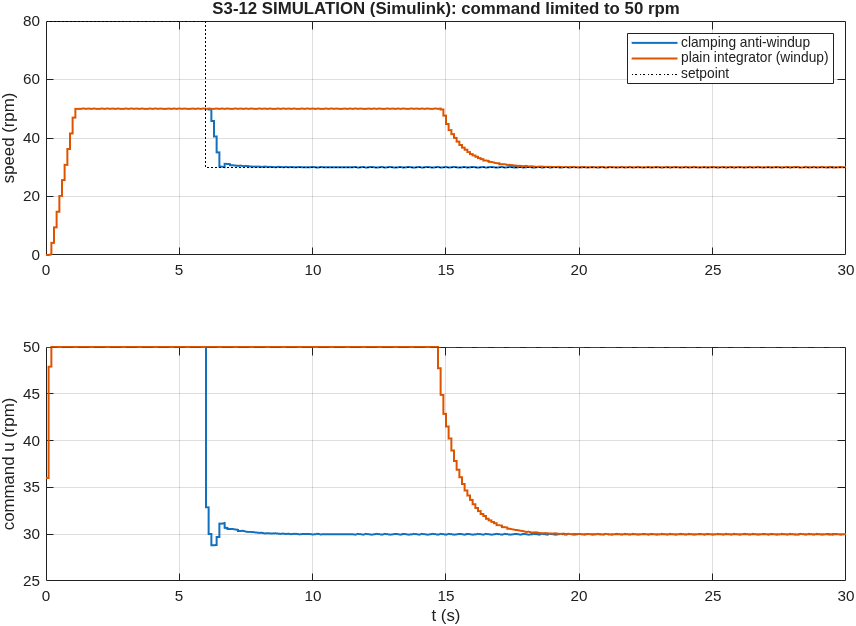

# ENR312 MOTOR handout: simulation and data-analysis results

Run `MOTOR-COURSE-SIM-20261021-123551`, generated 2026-10-21 12:35 by `matlab/scripts/motor_course_questions.m` (MATLAB 26.1.0.3346908 (R2026a) Update 5, Simulink 26.1).
Hardware data: runs of 2026-10-11 (data class HARDWARE). Everything else: SIMULATION.
Figures and CSV files are in `results/evidence/simulation_runs/dc_motor/MOTOR-COURSE-SIM-20261021-123551/`.

## S3-1 Motor, encoder and drive
RMCS-5032: 12 V, 180 rpm output no-load (18000 rpm base), 1:100, encoder 13 lines per motor rev. Drive: Rhino RMCS-2303.
Counts per output revolution with x4 decoding = 13 x 4 x 100 = **5200**; resolution = 360/5200 = **0.0692 deg**.

## S3-2 Speed resolution versus counting window
| window dt | resolution (1 count) = 60/(5200 dt) |
|---|---|
| 10 ms | 1.154 rpm |
| 50 ms | 0.231 rpm |
| 100 ms | 0.115 rpm |

The drive's speed register (loop **S**) moved in steps of 4.62 output rpm on the rig: that is one encoder LINE (not count) per window of 60/(13 x 461.5) = **10.0 ms**. Loop **E** counts all four edges over Ts = 100 ms: 0.115 rpm.

Trade-off (fig_S3-2_speed_windows.png): a longer window gives finer resolution and less noise, but the value is an average over the window, so it lags the true speed by about dt/2 and updates only once per window.

## S3-3 Static map: steady speed versus command

Our actuator command is a speed (output rpm, 0-180, firmware limit) instead of PWM 0-255; the drive closes its own loop, so the map is speed = command up to the voltage limit. Saturation: the physics model (ESTIMATED Ke) saturates at **168 rpm** at 11.2 V; the rig ran at **161-170 rpm** at full voltage (HARDWARE, 2026-10-11 runaway). Dead zone: **PENDING hardware** - run "Course S3-3: static map" (1, 2, 3, 5, 8 rpm steps, encoder feedback).

## S3-4 Identification from open-loop steps
First-order-plus-dead-time fit to each of the 24 measured steps (data_S3-4_fopdt_per_step.csv):
- K = **1.02 +- 0.06** output rpm per command rpm
- 40-rpm steps: tau = **0.34 s**, theta = 0.26 s;  20-rpm steps: tau = **0.12 s**, theta = 0.23 s
**Is first-order good enough? No.** tau depends on the step size, which a linear model cannot do. A model with a rate limit fits all four runs at once with K = 1.000, acceleration = **53.4 rpm/s**, tau = 4.72e-05 s, theta = 0 s (RMSE 2.34 rpm, close to the 1.33 rpm rms of the 4.6-rpm quantisation itself). The drive ramps the speed (acceleration register 5000 = 50 rpm/s) and its internal dynamics are faster than the 100 ms sampling can show.

Course first-order model for S3-9/S3-10 (fit to a 0 -> 60 rpm step, K fixed at the measured 1.0): **K = 1, tau = 0.72 s**. Hardware check: run "Course S3-2/S3-4: open-loop step".

## S3-5 Position P: final error
| run | Kp | target (deg) | final (deg) | error (deg) |
|---|---|---|---|---|
| MOTOR-04-HW-20261011-132143 | 0.3 | +90 | +90.00 | -0.00 |
| MOTOR-04-HW-20261011-132143 | 0.3 | -90 | -90.00 | +0.00 |
| MOTOR-04-HW-20261011-132143 | 0.3 | +360 | +360.00 | +0.00 |
| MOTOR-04-HW-20261011-132143 | 0.3 | +0 | -0.53 | +0.53 |
| MOTOR-04-HW-20261011-133810 | 0.3 | +90 | +89.95 | +0.05 |
| MOTOR-04-HW-20261011-133810 | 0.3 | -90 | -89.94 | -0.06 |
| MOTOR-04-HW-20261011-133810 | 0.3 | +360 | +359.99 | +0.01 |
| MOTOR-04-HW-20261011-133810 | 0.3 | +0 | -0.56 | +0.56 |
| MOTOR-05-HW-20261011-133840 | 0.2 | +90 | +89.82 | +0.18 |
| MOTOR-05-HW-20261011-133849 | 0.3 | +90 | +90.10 | -0.10 |
| MOTOR-05-HW-20261011-133858 | 0.5 | +90 | +89.95 | +0.05 |
HARDWARE: every move ends within **0.56 deg** (a few counts of 0.0692 deg) for Kp 0.2, 0.3, 0.5: no stopping short. The RMCS-2303 closes its own speed loop, so a command of even 1 rpm still turns the motor - the drive removes the dead zone that a bare PWM-driven motor has. With a dead zone d, P control stops where Kp*e < d, i.e. e_final = d/Kp (simulated in S3-11). Small 10 deg moves with Kp 0.1/0.3/1.0: **PENDING hardware** ("Course S3-5").

## S3-6 Loop time
Firmware now measures it with micros() (DIAG prints mean/max of the control law and of the whole sample) - **PENDING hardware** reading. Budget at 9600 baud (10 bits per character): read speed 33 ms, read position 38 ms, write command 35 ms per transaction, so one speed sample needs ~69 ms of the 100 ms period and the control law itself is microseconds. The loop period (Ts) and the ~70 ms command latency, not the arithmetic, limit the gains: delay adds phase lag, and the loop oscillates once Kp is large (rig model: Kp >= 1.2 in speed P).

## S3-7 Simulink identified model against the hardware runs

| run | loop | ctrl | Kp | Ki | RMSE | RMSE (% of setpoint) |
|---|---|---|---|---|---|---|
| MOTOR-05-HW-20261011-132405 | speed | P | 0.2 | 0 | 2.21 | 3.7 % |
| MOTOR-05-HW-20261011-132415 | speed | P | 0.5 | 0 | 3.24 | 5.4 % |
| MOTOR-05-HW-20261011-132424 | speed | P | 0.8 | 0 | 3.82 | 6.4 % |
| MOTOR-07-HW-20261011-132747 | speed | PI | 0.3 | 1.5 | 2.22 | 3.7 % |
| MOTOR-07-HW-20261011-133343 | speed | PI | 0.3 | 1.5 | 2.26 | 3.8 % |
| MOTOR-03-HW-20261011-132327 | speed | PI | 0.3 | 1.5 | 3.14 | 3.1 % |
| MOTOR-03-HW-20261011-133011 | speed | PI | 0.3 | 1.5 | 2.88 | 2.9 % |
| MOTOR-03-HW-20261011-133713 | speed | PI | 0.3 | 1.5 | 3.22 | 3.2 % |
| MOTOR-04-HW-20261011-132143 | position | P | 0.3 | 0 | 16.64 | 4.6 % |
| MOTOR-04-HW-20261011-133810 | position | P | 0.3 | 0 | 17.98 | 5.0 % |
| MOTOR-05-HW-20261011-133840 | position | P | 0.2 | 0 | 2.14 | 2.4 % |
| MOTOR-05-HW-20261011-133849 | position | P | 0.3 | 0 | 3.06 | 3.4 % |
| MOTOR-05-HW-20261011-133858 | position | P | 0.5 | 0 | 7.77 | 8.6 % |
| MOTOR-06-HW-20261011-132656 | position | I | 0 | 0.1 | 7.34 | 16.3 % |
Model: `matlab/models/dc_motor/enr312_motor_identified.slx` (Arduino PID with clamping, Modbus latency, dead zone, drive acceleration limit, K/(tau s+1), dead time, encoder/drive quantisation, backlash). Parameters fitted on the OPEN-LOOP runs only, so every closed-loop comparison above is a prediction.

## S3-8 +50 % inertia without retuning
| plant | loop | ctrl | J | overshoot % | settle (s) | e_ss % |
|---|---|---|---|---|---|---|
| rig | speed | P | x1.0 | 0.0 | NaN | 66.67 |
| rig | speed | P | x1.5 | 0.0 | NaN | 66.67 |
| bare | speed | P | x1.0 | 0.0 | NaN | 57.14 |
| bare | speed | P | x1.5 | 0.0 | NaN | 57.14 |
| rig | speed | I | x1.0 | 0.0 | 3.58 | 0.00 |
| rig | speed | I | x1.5 | 0.0 | 3.58 | 0.00 |
| bare | speed | I | x1.0 | 11.7 | 0.31 | 0.00 |
| bare | speed | I | x1.5 | 19.6 | 0.55 | -0.00 |
| rig | speed | PI | x1.0 | 9.2 | 2.33 | -0.00 |
| rig | speed | PI | x1.5 | 9.0 | 2.29 | -0.00 |
| bare | speed | PI | x1.0 | 0.0 | 0.27 | 0.00 |
| bare | speed | PI | x1.5 | 0.7 | 0.18 | -0.00 |
| rig | position | P | x1.0 | 1.9 | 1.28 | -0.00 |
| rig | position | P | x1.5 | 1.7 | 1.28 | -0.00 |
| bare | position | P | x1.0 | 18.3 | 0.38 | -0.00 |
| bare | position | P | x1.5 | 25.2 | 0.59 | -0.00 |
**Rig (drive in speed mode): the responses do not change.** The drive ramps at 50 rpm/s; accelerating 1.5 J at that rate needs 0.00079 N*m at the motor, the 3 A current limit gives 0.017 N*m (22x margin), so its speed loop hides the extra inertia. **Bare motor (voltage/PWM drive, course model): tau grows ~50 %**, the loops slow down and overshoot more; PI copes best in speed (integral action keeps e_ss = 0), P in position keeps zero error (type 1) but rings more.

## S3-9 I-only speed control
Plant G = K/(tau s+1), controller C = Ki/s. Loop: 1 + C G = 0  ->  s(tau s + 1) + K Ki = 0  ->  **tau s^2 + s + K Ki = 0**. Compare with s^2 + 2 zeta wn s + wn^2: wn = sqrt(K Ki/tau), **zeta = 1/(2 sqrt(tau K Ki))** - damping falls as 1/sqrt(Ki).
| Ki | zeta (tau 0.72 s) | predicted overshoot | identified-model overshoot |
|---|---|---|---|
| 0.5 | 0.83 | 1 % | 0 % |
| 1 | 0.59 | 10 % | 0 % |
| 2 | 0.42 | 24 % | 0 % |
| 4 | 0.30 | 38 % | 55 % |

The identified model departs from the formula in both directions. The rig is really fast (tau ~ 0) behind a 70 ms latency and a 53 rpm/s ramp; the 0.72 s "tau" is mostly the ramp time. At low Ki the integrator moves the command slower than the ramp, so there is no overshoot; at high Ki the latency adds phase lag and the overshoot exceeds the formula. Hardware: the earlier position I-only run (MOTOR-06, Ki 0.1) oscillated without settling, as two integrators predict; speed I-only sweep **PENDING hardware** ("Course S3-9").

## S3-10 PI design for zeta = 0.7
Closed loop with C = Kp + Ki/s: tau s^2 + (1 + K Kp) s + K Ki = 0. Matching s^2 + 2 zeta wn s + wn^2: **Ki = wn^2 tau / K, Kp = (2 zeta wn tau - 1)/K**. With K = 1, tau = 0.72 s, zeta = 0.7, wn = 2 rad/s: **Kp = 1.01, Ki = 2.87** (hardware preset uses 1.0 / 2.9). Predicted overshoot 4.6 %, 2 % settling 4/(zeta wn) = 2.9 s (the PI zero at -Ki/Kp adds a little overshoot).

30 -> 40 rpm step: first-order model overshoot 9.6 %; identified model **29 %** - the 70 ms latency and the sampling add phase lag the design ignored. Measurement **PENDING hardware** ("Course S3-10"). Earlier hand-tuned PI (Kp 0.3, Ki 1.5) measured 3-12 % overshoot (HARDWARE).

## S3-11 Why P position control can stop short, and backlash hunting

| Kp | final error, sim (deg) | d/Kp (deg) |
|---|---|---|
| 0.1 | 10.00 | 10.00 |
| 0.3 | 3.28 | 3.33 |
| 1.0 | 0.45 | 1.00 |
Type 1 means zero error for a LINEAR plant. Real drives have a dead zone (static friction, gearbox, driver drop): near the target Kp*e falls below it and the motor stops with e = d/Kp (table, 1 rpm dead zone, SIMULATION). Our rig showed <= 0.56 deg because the servo drive has no dead zone (S3-5). Backlash: with the sensor after the gears, an integrator keeps pushing while the gears cross the gap, overshoots, reverses, crosses the gap again: a limit cycle ("hunting": the output swings 1.8 deg peak-to-peak for ever, SIMULATION). Our encoder is on the motor shaft, so the loop does not see backlash (0.00 deg p-p): the output shaft simply rests -1.1 deg off (up to half the 3 deg gap).

## S3-12 Integral windup

Setpoint 80 rpm with the command limited to 50 rpm: the output saturates and the error stays at 30 rpm. A plain integrator keeps growing; when the setpoint drops to 30 rpm at t = 6 s it must first unwind, so the motor stays at 50 rpm for **10.3 s** before reaching 30 rpm; with clamping it takes **0.5 s**. The same happens with PWM at 255. Code (firmware pidStep, matlab pidStep.m): when the output is saturated and the error pushes further into saturation, stop integrating (`if (sat && sign(uRaw) == sign(e)) iNew = iOld;`). Hardware run: "Course S3-12".

## Pending hardware runs (MotorControlApp -> Hardware experiments)
Course S3-3 static map; S3-2/S3-4 open-loop step (drive vs encoder); S3-5 10-deg position P; S3-9 I-only Ki sweep; S3-10 designed PI; S3-12 saturation. Then DIAG after any run for S3-6 loop time.
