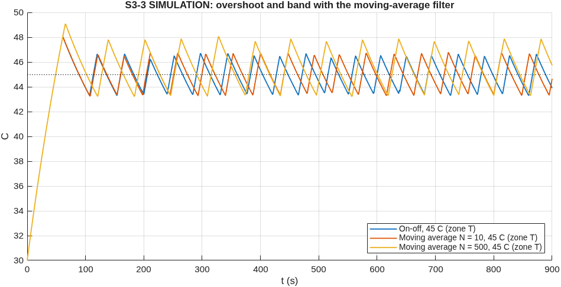
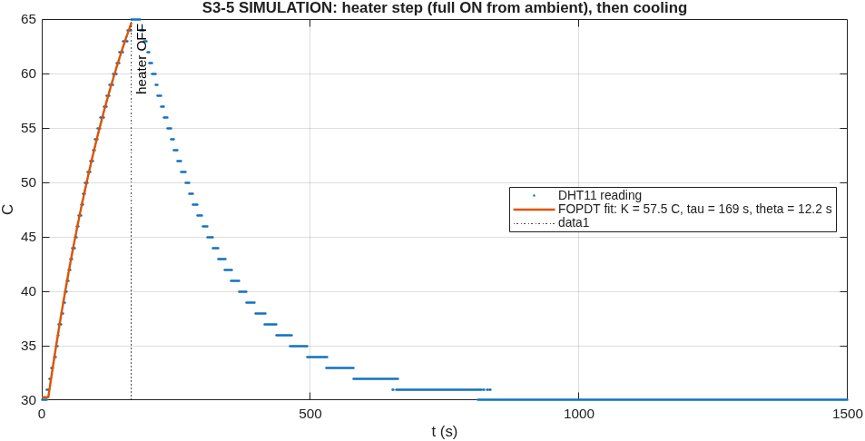
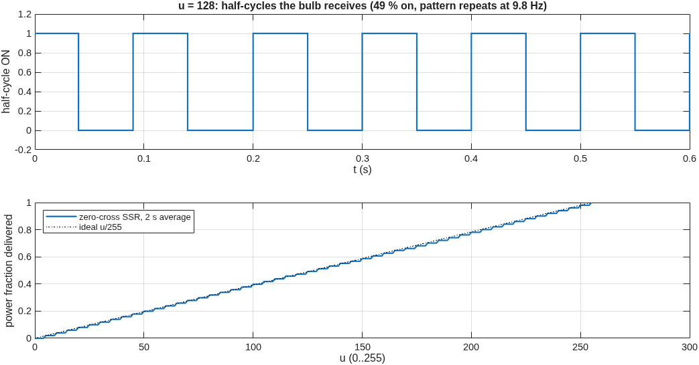
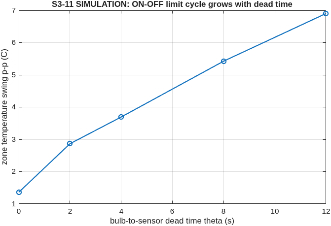
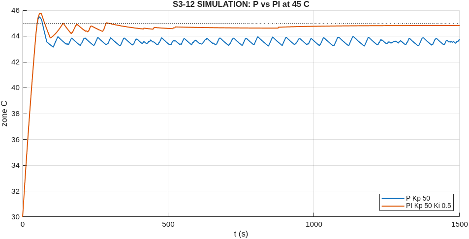

# ENR312 TEMP handout: simulation and analysis results

Run `TEMP-COURSE-SIM-20261024-120533`, generated 2026-10-24 12:05 by `matlab/scripts/temperature_course_questions.m` (MATLAB 26.1.0.3346908 (R2026a) Update 5, Simulink 26.1).
Data class: **SIMULATION** with ESTIMATED thermal constants (60 W bulb, R 1.00 K/W, C 150 J/K, delay 3 s, ambient 30 C). Every hardware question is listed as PENDING with the run to make. Sensor: DHT11.
Figures/CSV: `results/evidence/simulation_runs/temperature/TEMP-COURSE-SIM-20261024-120533/`.

## S3-1 DHT11 datasheet values
| quantity | DHT11 | DHT22 (AM2302) |
|---|---|---|
| temperature range | 0 to 50 C | -40 to 80 C |
| resolution | 1 C | 0.1 C |
| accuracy | +/- 2 C | +/- 0.5 C |
| minimum time between readings | 1 s | 2 s |
Values are the commonly published Aosong datasheet figures, status UNVERIFIED until the datasheet is filed (SRC-009). **55 C is outside the DHT11's rated 0-50 C**: above 50 C the reading is not specified, so at the 55 C setpoint trust it at best to +/- 2 C plus an unknown extrapolation error; check it against a thermometer (PENDING-HW).

## S3-2 / S3-3 Moving-average windows: span, distinct readings, delay
| N | span N x Ts | distinct DHT11 readings in the window | delay (N-1) Ts / 2 |
|---|---|---|---|
| 10 | 0.10 s | 1, occasionally 2 (a new reading every 1 s) | 0.045 s |
| 500 | 5.00 s | up to 6 | 2.495 s |
N = 10 spans 0.1 s, but the DHT11 gives a new value only once per second: the window almost always holds 10 copies of the SAME reading, so the average equals the reading and nothing is filtered - flicker unchanged. N = 500 spans 5 s = 5-6 different readings: the average moves in small steps between them, so the on/off decision changes less often, at the price of a 2.5 s delay.

| case | overshoot (C) | band p-p (C) | switches/min |
|---|---|---|---|
| On-off, 45 C | 2.00 | 2.00 | 2.6 |
| Moving average N = 10, 45 C | 2.00 | 2.00 | 2.4 |
| Moving average N = 500, 45 C | 3.00 | 3.00 | 1.8 |
The 2.5 s filter delay adds to the bulb-to-sensor delay: the heater stays on longer after the true temperature passes 45 C, so the overshoot grows (SIMULATION; hardware: TEMP-03/04 runs PENDING).

## S3-4 ON-OFF at 35 / 45 / 55 C: swing and switching period
| setpoint | swing p-p (reading) | switching period | switches/min | heater duty |
|---|---|---|---|---|
| 35 C | 2.0 C | 37.7 s | 2.6 | 11 % |
| 45 C | 2.0 C | 45.0 s | 2.6 | 30 % |
| 55 C | 3.0 C | 38.4 s | 3.0 | 49 % |
Trend: the higher the setpoint, the closer it is to the bulb's maximum (ambient + 54 C), so heating is slower and cooling faster near it - the duty rises and the ON part of each cycle gets longer. With the 1 C DHT11 steps the swing is never below one or two steps. Hardware: run On-off 35 / 45 / 55 C (PENDING-HW).

## S3-5 First-order-plus-dead-time model from the heating curve

Procedure (works the same on the rig with the "Heater step" preset): K = (T_final - T_start)/du, read where the curve flattens; theta = time before the reading starts to rise; tau = time from theta to 63 % of the rise. With the curve cut off at 65 C (safety), K comes from the least-squares fit: **K = 57.5 C at full power (0.225 C per PWM count), tau = 169 s, theta = 12.2 s** (RMSE 0.35 C). The model behind it has K = 54 C, tau = 150 s, a 3 s transport delay and a 10 s sensor lag - the fit lumps the lag into tau and theta.
Cooling (heater OFF): fitted tau = 156 s. In a single-R model heating and cooling share tau, but the rate differs: heating is driven by the full bulb power (slope K/tau at the start), cooling only by the losses, which shrink as the temperature falls towards ambient. On the rig cooling is usually slower still because the bulb, holder and enclosure keep releasing stored heat. Measurement **PENDING-HW** ("Heater step" preset).

## S3-6 PWM (490 Hz) into a zero-cross SSR (50 Hz mains)

A zero-cross SSR can only turn on at a mains zero crossing (every 10 ms) and stays on for that half-cycle. analogWrite(9, 128) is a 490 Hz square wave (2 ms period), so at each crossing the SSR sees whatever the PWM happens to be: about half the half-cycles are ON (49 % here), but in a pattern set by the beat between 490.2 Hz and 5 x 100 Hz = **9.8 Hz**: runs of ON and OFF half-cycles that the eye sees as flicker. When the error is near 0 the P output is small and keeps changing, so the pattern changes all the time - intense flicker. Use time-proportioning (TPROP mode, one switch per 2 s) or a phase-angle (random-turn-on) SSR for real proportional power.

## S3-7 Control signal for e = 10 C and e = 1 C
| Kp | u at e = 10 C | u at e = 1 C | saturated? |
|---|---|---|---|
| 1 | 10 | 1 |  |
| 2 | 20 | 2 |  |
| 50 | 255 | 50 | at 10 C |
| 100 | 255 | 100 | at 10 C |
| 500 | 255 | 255 | at 10 C and 1 C |
With Kp = 500 even a 1 C error asks for 500 -> clamped to 255 and any error < 0 gives 0: the output is 255 or 0 except within 0.5 C of the setpoint, and the DHT11 reads in 1 C steps, so it never sits in between - it is ON-OFF control.

## S3-8 / S3-9 Simulink model with K, tau, theta; hysteresis
Model: `matlab/models/temperature/enr312_temperature.slx` set from the fitted K, tau, theta (`enr312.temperature.withFOPDT`), DHT11 1 C resolution and 1 s update, 45 C.
| control | MATLAB swing | MATLAB period | MATLAB switches/min | Simulink swing | Simulink period | Simulink switches/min |
|---|---|---|---|---|---|---|
| ONOFF | 5.0 C | 62.6 s | 2.0 | 5.0 C | 63.0 s | 1.8 |
| HYST | 6.0 C | 75.0 s | 1.6 | 6.0 C | 75.9 s | 1.5 |
Hysteresis +/-0.5 C (band 1 C): the heater waits for the reading to leave the band, so with 1 C sensor steps it stops reacting to single-step jitter - fewer switches per minute, slightly larger swing. Arduino: mode HYST, band 1 C (already in the firmware). Compare with measured values: PENDING-HW (On-off 45 C and hysteresis presets).

## S3-10 P control: steady-state error
Plant (deviation from ambient): dT = K u / (tau s + 1), u = Kp e, e = r - T. At steady state dT = K Kp e, and r - T_a = e + dT = e (1 + K Kp), so **e_ss = (r - T_a)/(1 + K Kp)** (r measured from ambient). K = 0.212 C per count (ESTIMATED; from the step fit on the rig).
| Kp | predicted e_ss at 45 C | simulated, average SSR | simulated, zero-cross SSR |
|---|---|---|---|
| 1 | 12.38 C | 12.11 C | 13.00 C |
| 2 | 10.54 C | 10.58 C | 11.00 C |
| 50 | 1.29 C | 1.28 C | 1.28 C |
| 100 | 0.68 C | 0.68 C | 0.67 C |
| 500 | 0.14 C | 0.14 C | 0.14 C |
For large Kp the formula predicts < 1 C but the 1 C sensor steps and the delay make the loop oscillate (limit cycle) instead: compare the mean, not a single reading. Measured: PENDING-HW (P Kp presets).

## S3-11 Limit cycle and dead time

ON-OFF has no "middle" output: the heater is either full on or off, so the temperature must keep moving; it can only reverse after the reading crosses the setpoint, and the reading arrives theta seconds late. During that time the temperature keeps rising at about (heating slope) x theta above, and falling at (cooling slope) x theta below: a steady oscillation whose size grows with theta (table/figure: 1.4 C p-p at 0 s, 6.9 C at 12 s; the remaining swing at 0 s comes from the sensor lag and the 1 C steps).

## S3-12 PI with anti-windup
```
every Ts:                          // firmware mode PI (temperature_controller.ino)
  e = setpoint - T
  iNew = I + Ki * Ts * e
  uRaw = Kp * e + iNew
  if not ((uRaw > 255 and e > 0) or (uRaw < 0 and e < 0)):  I = iNew   // clamp: freeze I at the limits
  u = constrain(round(Kp * e + I), 0, 255)
  analogWrite(9, u)
```

| mode | mean error | overshoot | time to reach | 
|---|---|---|---|
| P | +1.29 C | 0.00 C | 65 s |
| PI | +0.00 C | 0.00 C | 64 s |
Prediction for 45 C: P leaves an offset (S3-10); PI removes it - the integral keeps adding power until the mean reading is 45 C. Without clamping the integral would grow during the long warm-up at u = 255 and cause a large overshoot; with clamping it starts integrating only once u leaves 255. Hardware: preset "PI Kp = 50, Ki = 0.5" (PENDING-HW).

## Pending hardware runs (enr312_temp, on the rig)
Heater step (K, tau, theta) first; then On-off 35/45/55 C, hysteresis +/-0.5 C, MA N = 10 and 500, P Kp 1/2/50/100/500, PI; check the 55 C readings against a thermometer.
